# DeutschPath 🇩🇪
### تعلم الألمانية بنفسك — Learn German on Your Own

A structured German learning web app built specifically 
for Arabic speakers, covering A1 to B2 with daily lessons, 
vocabulary, listening, reading, and exam simulation.

🔗 **Live Demo:** [deutschpath.vercel.app](https://deutschpath.vercel.app)
🔑 **Free Access Code:** FREE-ACCESS

---

## About

DeutschPath was born from a real problem — Arabic-speaking 
learners in Morocco have almost no affordable tools to learn 
German on their own. Most platforms are expensive, English-first, 
or not designed for Arabic speakers at all.

I built this app solo to solve that problem with zero budget 
for infrastructure. The entire app runs without a backend or 
database by design — not due to lack of skill, but as a 
deliberate choice to keep it completely free to host and 
accessible to anyone with a browser.

Progress, vocabulary, and access control are all handled 
client-side using localStorage and a serverless access 
verification endpoint — making the app 100% free to run 
on Vercel with no monthly costs.

The result is a real product with real paying users that 
costs nothing to maintain and nothing to access for learners 
on a tight budget.

If rebuilt with a proper backend, this architecture could 
easily scale to a full SaaS platform with user accounts, 
payment integration, progress sync across devices, and 
an admin dashboard — the foundation is already there.

---

## How I Use AI Professionally (Cursor + Antigravity)

I built DeutschPath using AI as a professional development partner, not just as a code generator. I used Cursor for fast implementation, refactoring, debugging, and component-level development, while Antigravity helped me think more clearly about structure, product flow, maintainability, and user experience.

My workflow was:
- Plan the feature first: define the learning journey, user needs, and layout.
- Build the UI quickly: create reusable components, tabs, cards, and modules.
- Refine with AI: improve code quality, fix bugs, and reduce repetition.
- Review everything manually: validate logic, design, accessibility, and correctness.
- Document and improve: keep the product clear, polished, and easier to scale.

This is the professional way I use AI:
- It accelerates development.
- It helps me explore ideas faster.
- It improves productivity without replacing product judgment.
- It allows me to focus more on quality, clarity, and user value.

---

## Screenshots

The screenshots below are already stored in the screenshots folder and are referenced directly in this README.

### Main Dashboard
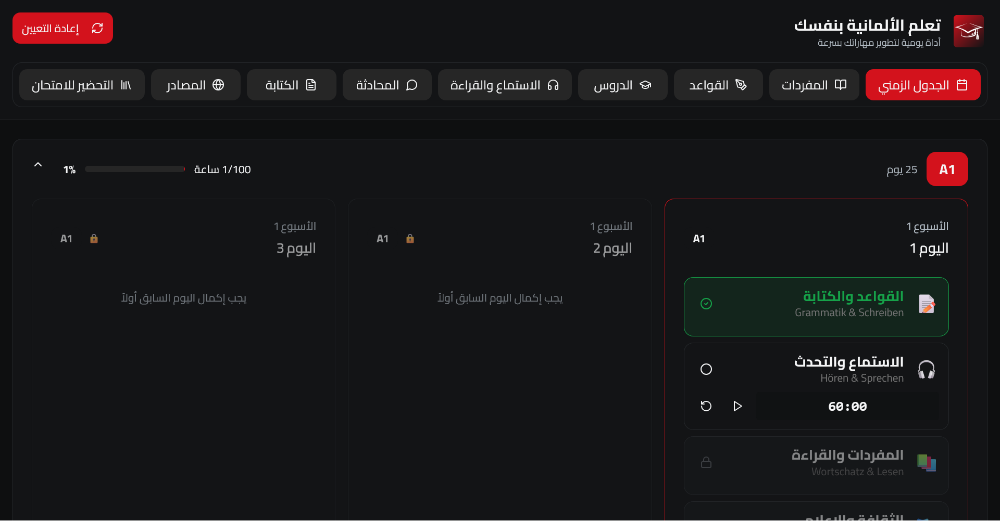
The main learning dashboard presents the app’s structure, navigation, and core learning entry points in one polished interface.

### Study Schedule

The study planner gives learners a structured weekly path with daily goals, study hours, and progression-based unlocks.

### Vocabulary System
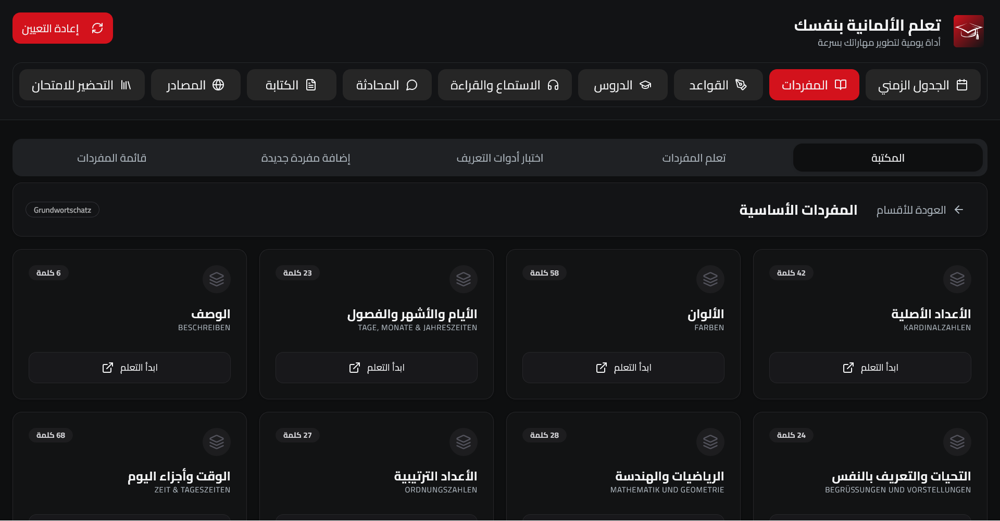
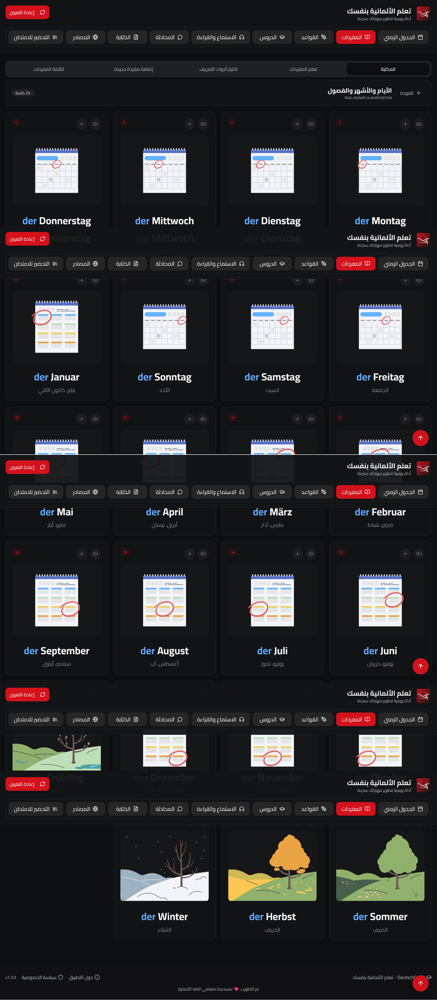
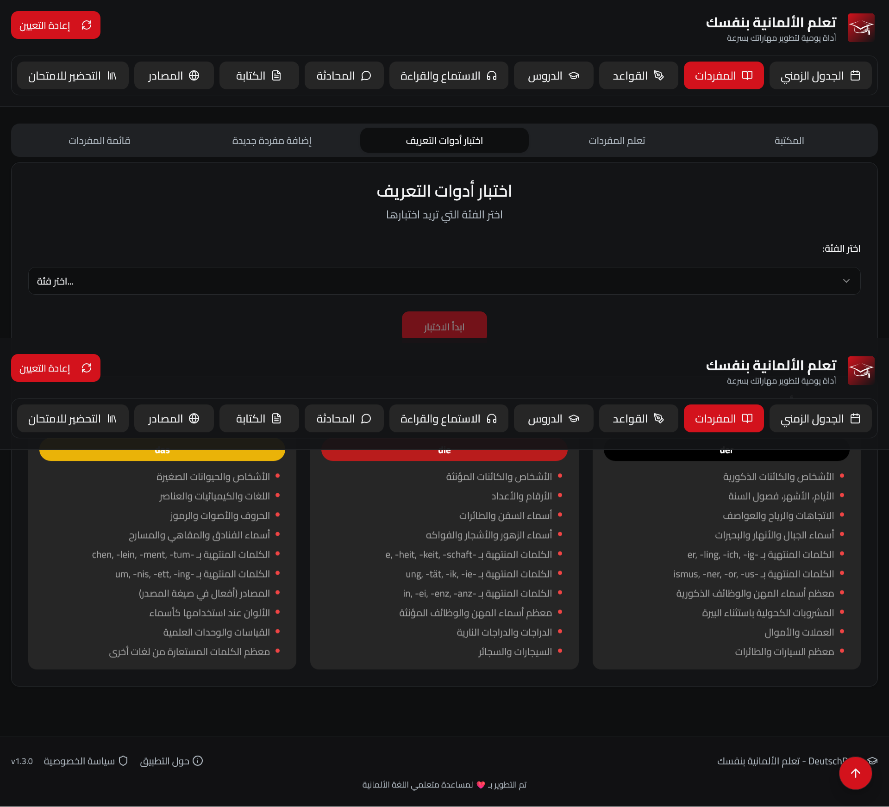
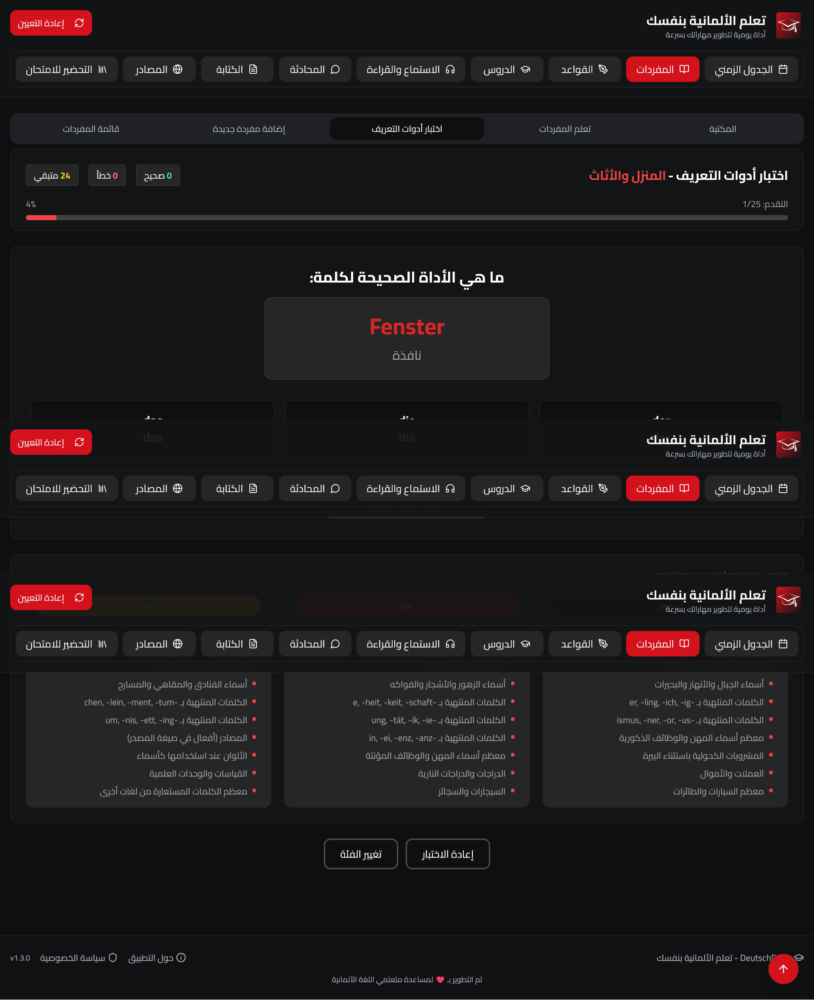
The vocabulary experience allows learners to manage German words, meanings, pronunciation, and personal study lists in a clean and practical workflow.

### Grammar & Verbs
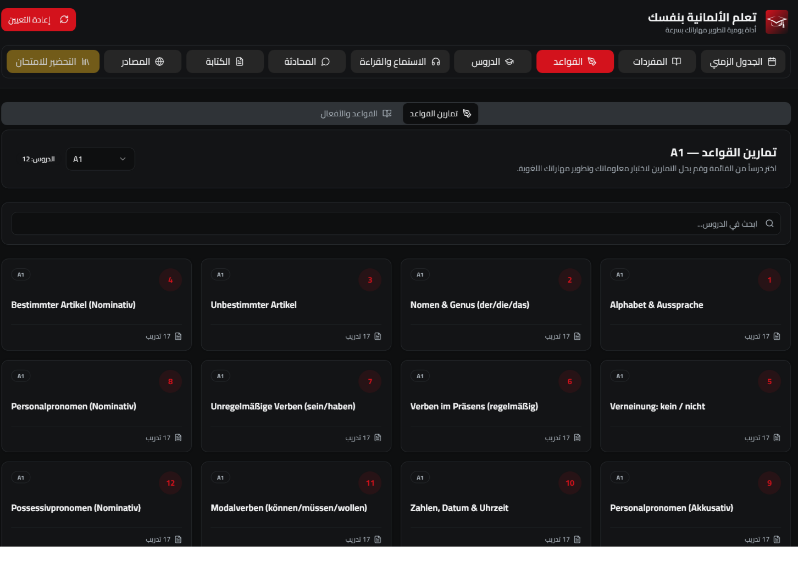
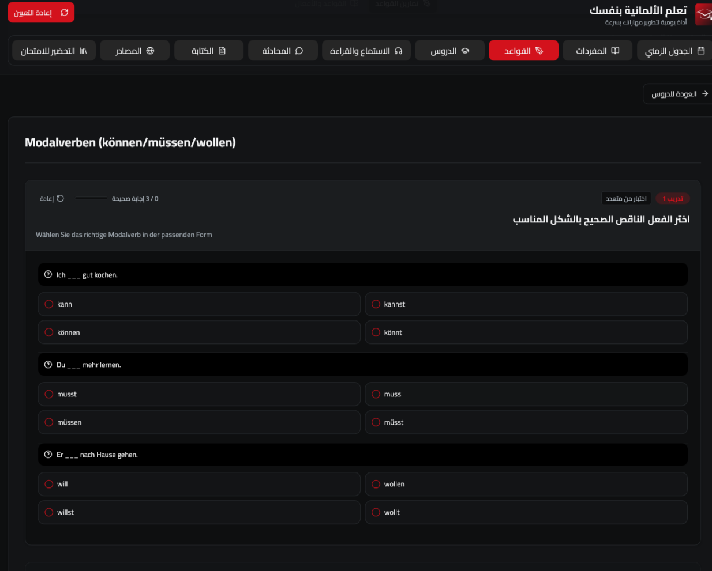
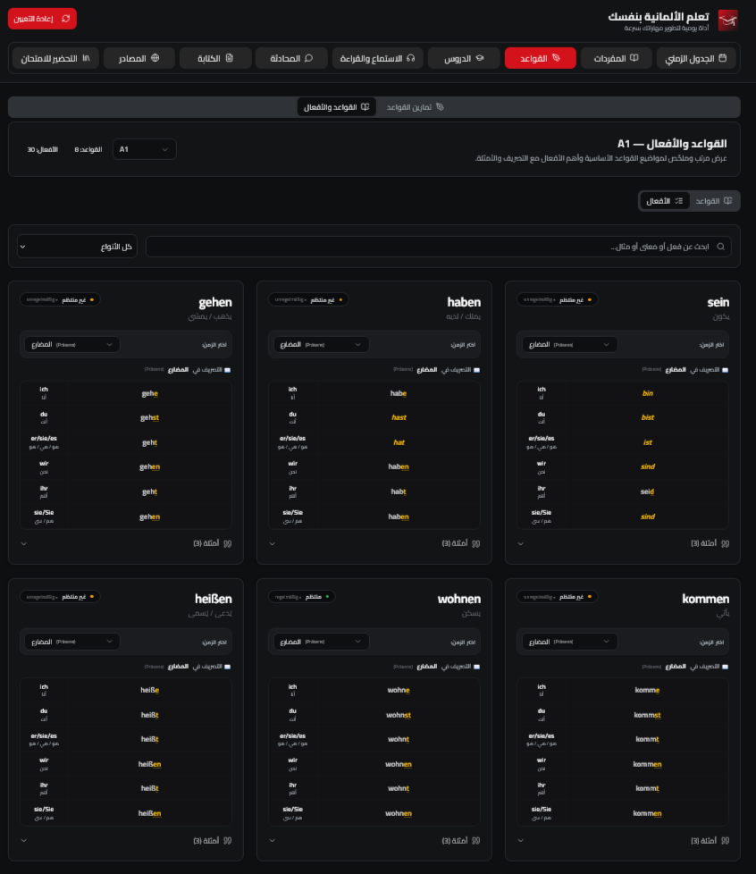
The grammar and verb modules provide structured explanations and examples for German learners, with an emphasis on clarity and usability.

### Lessons
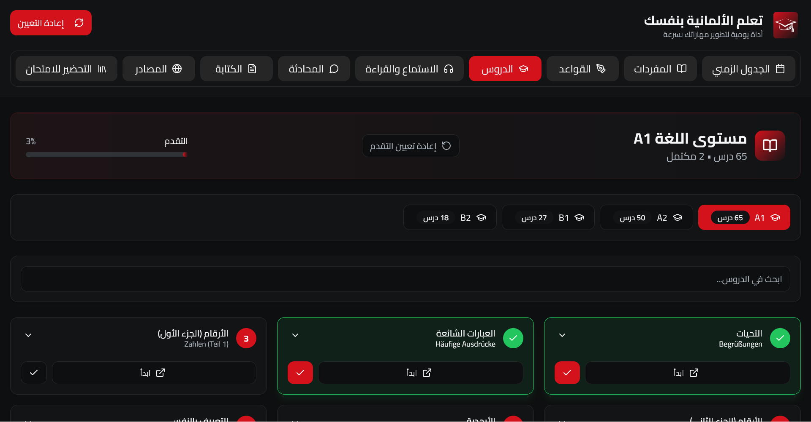
The lessons section organizes content by proficiency level and supports guided study progression from A1 to B2.

### Reading Practice
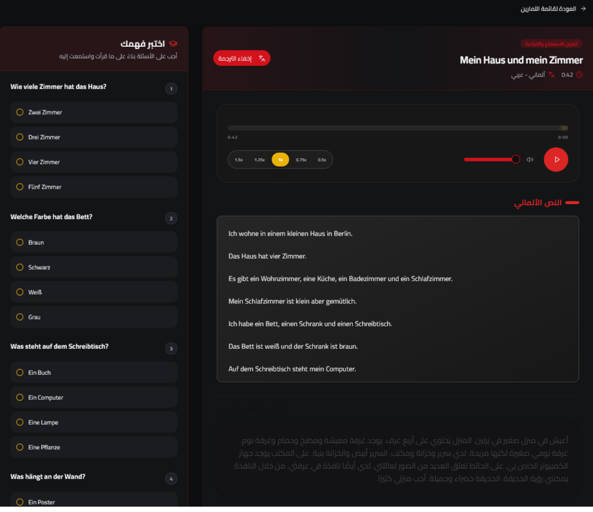
The reading module focuses on comprehension and text-based practice, with support for narration and guided interaction.

### Resources & Preparation
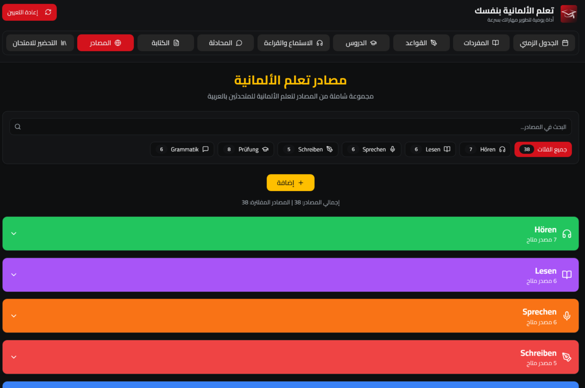
The resources area includes curated learning materials and preparation support to help learners continue beyond the core lessons.

### Speaking Conversation
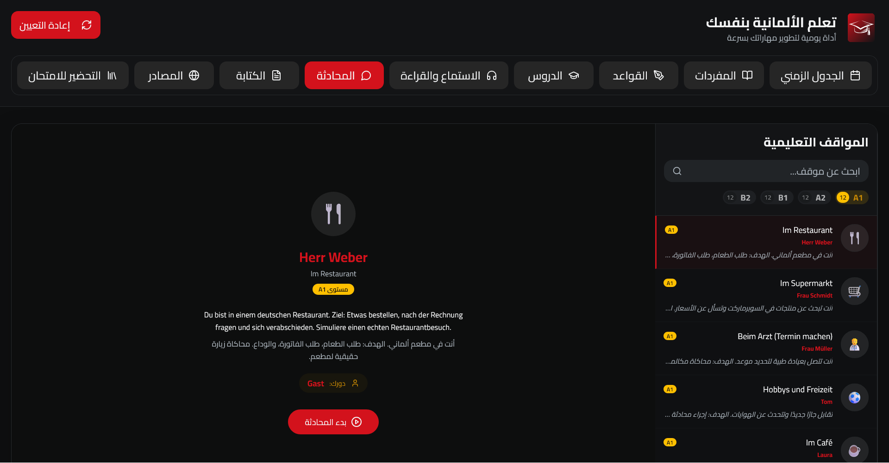
The speaking experience includes an interactive AI-driven conversation flow designed to simulate real spoken practice and support German communication skills.

### Writing Practice
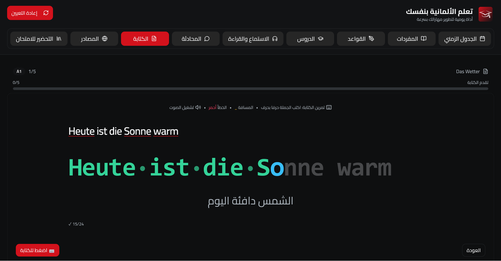
The writing module supports written expression practice and is designed as part of the broader exam preparation experience.

### Exam Simulation
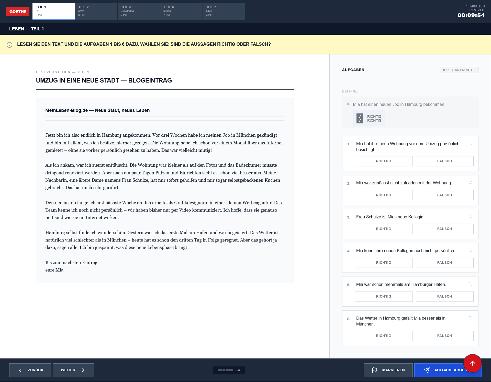
The exam simulation brings together reading, listening, writing, and speaking into a complete preparation experience that mirrors the structure of official German exam practice.

---

## Core Components & Features

DeutschPath is not just a content app; it is a complete learning product experience built around modular React components and a polished user journey.

### Product Modules
- 📅 Study Schedule — Structured daily and weekly planning with progress tracking and level-based unlocks
- 📚 Vocabulary System — Personalized vocabulary management with German terms, translations, pronunciation, and custom word lists
- 📝 Grammar & Verbs — Reference-focused modules for grammar rules, verb patterns, and example usage
- 🎓 Lessons — Organized lesson content across A1, A2, B1, and B2 with clear progression
- 🎧 Listening Practice — Audio-based exercises with control and review features
- 📖 Reading Practice — Reading activities with comprehension-focused interaction
- 🗣️ Speaking Conversation — AI-assisted speaking practice with conversational flow and feedback logic
- ✍️ Writing Practice — Structured writing tasks that support exam-style preparation
- 🧪 Exam Simulation — A full mock-exam experience covering listening, reading, writing, and speaking

### Key App Components
- 🧭 Tab Navigation — A central navigation system that organizes the learning experience into clear sections
- 🔐 Access Gate — A premium-style access system with free, trial, and paid access logic
- 🧠 Speaking Conversation Flow — Interactive AI-driven conversation logic built around user input and guided responses
- 🧪 Exam Engine — Modular exam workflow with instruction screens, progress handling, and results presentation
- 🔊 Text-to-Speech Support — Voice narration and audio interaction to improve listening and reading experience
- 📱 Responsive UI — A mobile-friendly experience designed for accessibility and ease of use
- 🌐 RTL Arabic/German Experience — A bilingual interface tailored for Arabic-speaking learners

### Platform & Product Features
- 💾 Local Persistence — User progress, vocabulary, and preferences are stored locally in the browser
- 🔒 Access Control — Supports free access, trial access, and paid access workflows through code-based verification
- 📈 Learning Flow — Designed to guide users from study to practice to exam preparation in a cohesive path
- 🛠️ Modular Architecture — The app is organized into reusable, feature-oriented components for maintainability and future growth
- 🚀 Scalable Foundation — The current product is lightweight and cost-efficient, but the architecture is ready for future expansion with backend services and richer user accounts

---

## Tech Stack

| Layer | Technology |
|-------|-----------|
| Framework | React 18 + TypeScript |
| Styling | Tailwind CSS + ShadCN UI |
| Components | Radix UI |
| Routing | React Router |
| State | React Context + React Query |
| Persistence | localStorage |
| Build tool | Vite |
| Deployment | Vercel |

---

## Access Tiers

| Tier | Features |
|------|----------|
| Free | Limited lessons and vocabulary |
| Test | Full access for evaluation |
| Paid | Complete A1→B2 content unlocked |

Access is managed via unique codes provided manually 
per user — no online payment system required.

---

## Who Is This For

- Arabic speakers preparing for Goethe, TestDaF, or 
  Ausbildung in Germany
- Moroccan students targeting B1/B2 certification
- Self-learners who prefer Arabic-first explanations

---

## Production & Deployment

The app is deployed and managed through Vercel with a lightweight production setup focused on speed, reliability, and low operational cost. The deployment workflow is designed for continuous delivery, fast iteration, and simple production monitoring.

In production, I treat configuration and deployment carefully by separating development and production environments, managing secrets securely, and keeping deployment steps predictable. The app is also structured to support future optimization through caching, CDN delivery, and more advanced backend services when the product scales.

In a broader product context, the next step would be to introduce more robust backend services for user accounts, content management, analytics, and session persistence. That could include managed databases, caching layers, and a more structured API layer while preserving the same frontend experience.

## Notes

- Built solo — idea, design, development, and deployment
- Zero infrastructure cost — runs entirely on Vercel free tier
- No backend by design — localStorage handles all persistence
- Real paying users — access codes sold and distributed manually
- Version 1.4.2 currently live
- Built specifically for the Moroccan/Arabic-speaking market
- Could scale to full SaaS with backend integration